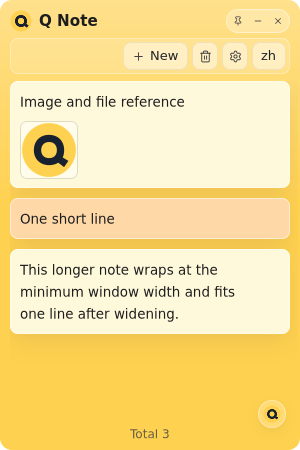
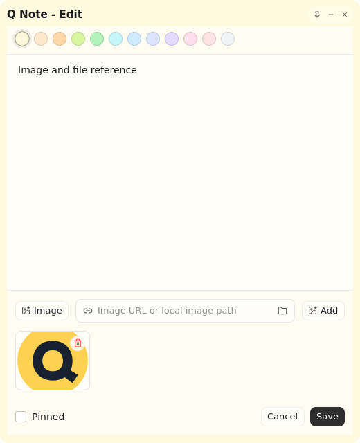

<p align="center"></p>
<h1 align="center">Q Note</h1>
<p align="center">保存经常复制的文本、图片和文件路径的紧凑桌面便签板。<a href="./README.md">English</a></p>

## Native Shell 版本

此分支使用 [Longbridge Native Shell](https://github.com/longbridge/nsh) 0.1.1 和 Rust 重新实现 Q Note。TSX 描述原生控件，图标通过 Canvas 绘制，不包含 WebView、Vue 或 React 运行时。面向 Windows、macOS 和 Linux；不处理移动端。

| 主面板                                                               | 独立编辑窗口                                                             |
| -------------------------------------------------------------------- | ------------------------------------------------------------------------ |
|  |  |

点击卡片复制内容；支持置顶、改色、拖动排序、逐行调整文字高度。独立编辑窗口支持图片选择、URL/路径、文件拖入、截图粘贴和附件管理。图片预览支持切换、缩放、平移和键盘操作。主面板可收起为 30px Q 悬浮球，支持贴边半隐藏与悬停展开。中英文、全局置顶、托盘恢复、开机启动、JSON 导入导出和经过大小/摘要校验的程序更新均已实现。

完整产品规则见 [功能规格](./docs/FEATURES.md)，架构和验证边界见 [Native Shell 说明](./docs/NATIVE_SHELL.md)。

## 开发

需要 Rust stable、Node.js 24、pnpm 和 [GitHub CLI](https://cli.github.com/)。先登录 `gh` 或设置 `GH_TOKEN`，用于下载固定版本的 NSH。macOS 需要 Xcode 命令行工具；Windows 需要 Visual Studio C++ 工作负载及 Windows SDK；Linux 需要 GTK 4 开发包、libclang、CMake、pkg-config 和带文件选择器 portal 的桌面会话。

```bash
# Ubuntu 24.04 及以上
sudo apt-get install libgtk-4-dev libclang-dev cmake pkg-config
pnpm install
pnpm setup
pnpm dev
```

| 命令                             | 用途                               |
| -------------------------------- | ---------------------------------- |
| `pnpm typecheck`                 | 检查主面板、编辑窗、悬浮球三个入口 |
| `pnpm test`                      | Rust 数据/交互规则及更新清单测试   |
| `pnpm build:ui`                  | 生成嵌入程序的原生 UI 包           |
| `cargo build -p q-note --locked` | UI 打包后编译调试程序              |
| `pnpm check`                     | 类型、格式和 Rust 检查             |
| `pnpm format`                    | 格式化 TSX、脚本和 Rust            |
| `pnpm build`                     | 类型检查、UI 打包和 release 编译   |
| `pnpm package`                   | 当前平台打包到 `dist/packages`     |
| `pnpm test:desktop`              | Linux 真实原生窗口回归             |

窗口回归需要 `xvfb openbox xdotool xclip imagemagick dbus-x11`，截图和日志写入 `dist/smoke`。手动测试时用 `Q_NOTE_DATA_DIR=/测试目录` 隔离个人数据。离线开发可以设置 `NSH_BIN`、`NSH_SOURCE` 指向匹配的 0.1.1 CLI 和源码。上游只提供 ARM macOS CLI，Intel macOS 会从固定源码编译 CLI。

## 数据兼容

数据库路径保持不变：Windows 为 `C:\Users\<用户名>\.q-note\q-note.db`，macOS/Linux 为 `~/.q-note/q-note.db`。新文件尚不存在时，先复制旧位置 `%APPDATA%\com.win11.q-note\q-note.db`，包含尚在 SQLite 日志中的内容；不覆盖已有新文件，也不删除旧文件。

原有便签、附件、色板、置顶、排序、文字高度、语言、窗口状态及设置继续兼容。导出 JSON 包含格式版本、导出时间、便签、附件和设置；导入整体替换，取消、解析失败或写入失败均保留原数据。

## 打包与发布

本分支发布 Windows x64 便携 `.zip`、Linux x64 `.tar.gz`（需要 GTK 4）以及 Apple Silicon/Intel macOS `.app.zip`。UI 和图标嵌入可执行程序。macOS 可执行文件使用临时签名，未进行 Developer ID 公证。

```bash
pnpm release:patch
pnpm release:minor
pnpm release:major
```

命令同步 `package.json`、根 `Cargo.toml`、`ui/nsh.json` 和根 `Cargo.lock`，创建版本提交和标签后推送。必须保留 `bumpp --all`，确保锁文件一起提交。标签触发原生构建并发布安装归档、更新可执行文件、SHA-256/大小元数据和 `latest.json`。应用内更新先保存数据、窗口状态和未完成草稿，再替换程序；新进程等待旧进程退出后启动。程序目录不可写时提示安装失败并保留数据。

macOS 可能需要在“隐私与安全性”中选择“仍要打开”，或在 Finder 右键选择“打开”。Linux Wayland 对窗口定位和置顶的限制由合成器决定；不支持时安全降级。Linux 桌面没有托盘宿主时，可再次启动程序来恢复主面板。

## 许可证

[MIT](./LICENSE)
